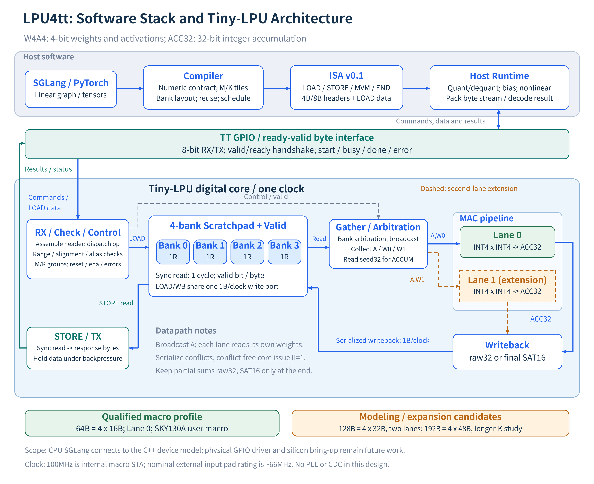

# LPU4tt

**A compiler-driven Tiny-LPU ISA and executable modeling stack for Tiny Tapeout.**

LPU4tt explores how a small, explicitly scheduled integer accelerator can be
derived from software workloads. It includes ISA v0.1, independent functional
execution, resource and full-device cycle models, compiler experiments, numerical
precision comparisons, and a matching parameterized RTL implementation.
The design takes inspiration from Groq's static scheduling and streaming
execution; it is an independent research implementation with its own ISA.

## Start here

| Topic | Entry point |
| --- | --- |
| ISA encoding, arithmetic and errors | [ISA v0.1](docs/isa_v0.md) |
| Functional, resource and cycle modeling | [Modeling guide](docs/modeling.md) |
| Current architecture and profiles | [Architecture](architecture.md) |
| Complete device timing and GPIO contract | [Device contract](docs/device_rtl_contract.md) |
| Capacity, lanes and workload trade-offs | [Device performance](docs/device_performance.md) |
| INT4, INT8, FP16 and BF16 comparison | [Precision study](docs/precision_results.md) |
| Compiler, Relax and SGLang integration | [Compiler guide](compiler.md) |
| Tests, evidence and scope | [Validation](validation.md) |
| All documentation | [Documentation index](docs/README.md) |

## ISA at a glance

| Instruction | Header | Operation |
| --- | ---: | --- |
| LOAD | 4 bytes | Copy following literal bytes into scratchpad |
| STORE | 4 bytes | Return scratchpad bytes to the host |
| MVM | 8 bytes | Compute an explicitly addressed integer matrix-vector tile |
| END | 4 bytes | Finish the command stream |

The base device uses signed INT4 weights and activations, INT32 accumulation,
explicit K tiling and partial sums, and raw32 or final SAT16 output. Scale
handling, graph management, nonlinear operations and KV state belong to the host.
INT8 is an optional ISA-model experiment. FP16/BF16 are numerical references;
none of these three types is a native capability of the released RTL.

## Quick start

Use Linux, C++17, CMake >= 3.16 and Python 3.11. The full pinned environment
includes CPU PyTorch and TVM; no GPU is required.

~~~sh
git clone https://github.com/Jingnin-S/LPU4tt.git
cd LPU4tt
python3.11 -m venv .venv
.venv/bin/python -m pip install -r requirements.txt
PYTHON=.venv/bin/python bash scripts/check_release.sh
~~~

This builds the C++ libraries and runs CTest, analysis and software tests,
dependency checks, and a real torch.export -> Relax -> fused VM callback ->
ISA execution smoke test. A small dependency-free C++ model build is also possible:

~~~sh
cmake -S . -B build_esl -DCMAKE_BUILD_TYPE=Debug
cmake --build build_esl --parallel 2
ctest --test-dir build_esl --output-on-failure
~~~

Reproduce ISA, cycle, operator and numerical studies with the commands in the
[modeling guide](docs/modeling.md). Generated full artifacts remain separate
from the compact checked-in reference results.

## Profiles and evidence

| Profile | Status |
| --- | --- |
| 64B, one lane, four banks, W4A4/ACC32 | Public default; bounded SKY130A macro qualification |
| 128B, two lanes, four banks | Executable model and RTL regression configuration |
| 192B, four banks | Longer-K storage candidate in architecture/ISA modeling |
| 256B, one/two lanes | Executable device model and RTL regression comparison |

The qualified 64B/one-lane user macro uses 4x2 tiles and a 10 ns internal
clock constraint. Recorded nine-corner post-route setup/hold slacks are positive;
cap/slew, DRC/LVS and antenna checks pass, as do gate vectors and TT precheck.
The retained max-fanout diagnostics are reported separately.
[Qualification details](docs/tt_signoff_results.md) bind these claims to
specific RTL and artifact hashes. This is not silicon measurement, board
frequency qualification, whole-chip power signoff or shuttle acceptance.
The current design has one external clock and no PLL/CDC.

The upstream experiment connects CPU SGLang ReplicatedLinear to the C++ device
model. Full SRT serving and a physical GPIO host driver remain future work.
Synthetic quantization accuracy does not establish real-model perplexity.

## Repository map

~~~text
compiler/     Python frontend, ISA lowering, scheduling and runtime
cpp/, hpp/    Independent C++ functional, resource and full-device models
configs/      ISA, workload, resource and SKY/IHP/GF template snapshots
docs/         English contracts, experiment explanations and editable diagram
reports/      Compact reproducible results and source-bound reference evidence
tests/        C++ and Python checks; RTL comparison and arithmetic tests
rtl/, src/    Parameterized device RTL and Tiny Tapeout public wrapper
scripts/      Experiment, validation and physical reproduction entry points
physical/repro/  Locked physical toolchain and cache verification
~~~

Repository release **v0.2.1** keeps **ISA v0.1** unchanged. The Python distribution
retains the name tinylpu. See [release notes](docs/release_notes_v0_2_1.md),
[reproducibility](REPRODUCIBILITY.md), and [third-party notices](THIRD_PARTY.md).
Original project code and documentation are [MIT licensed](LICENSE).
