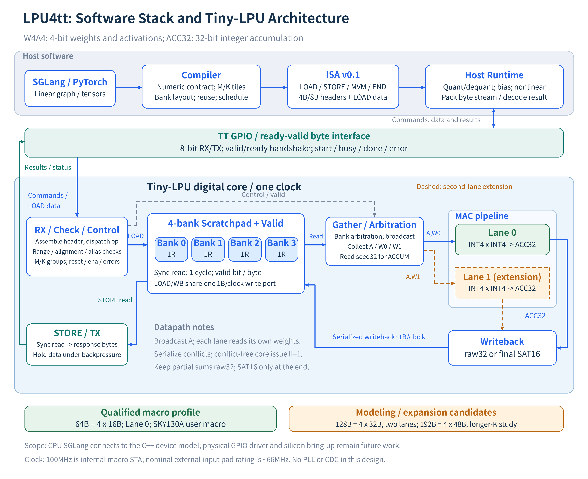

# LPU4tt architecture

The host compiler schedules integer linear tiles and emits ISA v0.1 commands.
The device executes a single in-order byte stream. Graph control, quantization
scales, nonlinear functions, attention/KV state and sampling stay on the host.

## Current profiles

| Component | Public default | Experimental alternatives |
| --- | --- | --- |
| Arithmetic | W4A4, ACC32, raw32/final SAT16 | INT8 ISA model; FP16/BF16 numerical references |
| Compute | One MAC lane | Two-lane model/RTL; wider resource studies |
| Scratchpad | 64 bytes, four byte-interleaved banks | 128B dual-lane; 192B longer-K candidate; 256B comparison |
| Reads | One synchronous read per bank, one-cycle response | Explicit flat-port resource comparisons |
| Writes | One byte per bank per clock | LOAD writes one bank; result writeback writes one lane per clock |
| Control | Sequential LOAD/STORE/MVM/END | No instruction RAM, asynchronous DMA or descriptor cache |
| Clock | One synchronous clock | No internal PLL or CDC bridge |

Only the v0.2.1 64B/one-lane SKY130A macro has a recorded physical qualification;
the current RTL has changed since and has not been through the physical flow. Parameterized model/RTL support is a separate claim.

## Data and control paths

The byte framer gathers a 4B or 8B header. Boundary computation, MVM validation
and checking precede dispatch. A four-bank scratchpad stores data and one valid
bit per byte; data cells do not require reset.

For each K element, the gather arbiter requests A and each active lane's weight.
Each fetched byte supplies two K elements: both nibble products are formed and
summed before accumulation. Identical addresses broadcast once. Different
addresses in the same bank are serialized in A, W0, W1 priority. A is shared across lanes, while each lane owns
an INT32 feedback accumulator. Explicit product/valid staging permits one byte
issue (two K elements) per clock in a conflict-free group; bank conflicts reduce that rate.

ACCUM reads each raw32 seed with one four-bank read before a row group starts. Intermediate
K tiles retain raw32. Final SAT16 is explicit and affects only output storage.
Writeback stores one lane per clock across the banks. STORE reads ahead of the
registered TX byte and holds TX valid/data during backpressure.

## Compiler decisions

The compiler compares row/K tile sizes, weight-stationary and frame-major order,
packed and bank-padded layouts, capacity, lane count and output width.
Padding consumes real storage and wire bytes. Its reduction in conflicts can
also shrink a feasible K tile. More lanes therefore need not increase throughput.
Fusion is selected only when source dependencies and numeric boundaries allow it.

The [modeling guide](docs/modeling.md) separates functional execution, resource
estimates and the exact implemented device FSM. Use the [device contract](docs/device_rtl_contract.md)
for current cycle counts. The older [architecture study](docs/architecture_v1.md)
preserves the original 128B/two-lane exploration and idealized resource assumptions.

## Physical boundary

The qualified macro uses 4x2 SKY130A tiles and a 100 MHz internal STA constraint.
It does not qualify the whole-chip clock path, board GPIO or a 100 MHz external
interface. [Clock notes](docs/gpio_clock_notes.md) and
[qualification results](docs/tt_signoff_results.md) define those limits.
