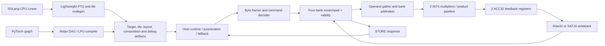

# Tiny-LPU architecture v1

> Historical resource/probe study. Its 128B/two-lane recommendation and
> implementation-to-do statements describe that stage, not the current release.
> Current device and physical status: [architecture](../architecture.md),
> [device contract](device_rtl_contract.md), [qualification](tt_signoff_results.md).

2026-11-04. This is a complete **logical architecture and software integration
proposal**, backed by numerical execution, resource experiments and selected RTL
probes. It is not a finished chip RTL, routed design or tapeout signoff.

## System boundary and recommended configuration

The host owns model graphs, request scheduling, tensors, quantization scales,
nonlinear functions, attention/KV state and sampling. Tiny-LPU executes explicitly
scheduled integer linear tiles. There is one device command stream and no
instruction RAM, speculative execution, hardware cache or asynchronous DMA.

| Component | Recommended baseline | Alternative and purpose |
| --- | --- | --- |
| ISA | v0.1 LOAD/STORE/MVM/END, 4/8B headers | old ABI-v1 remains a baseline |
| Arithmetic | signed INT4 products, ACC32, raw32/SAT16 | INT8 reference/profile; no base floating MAC |
| Compute | 2 lanes, one feedback accumulator per lane | 1 lane/64B low-resource comparison |
| Data storage | 128B, four byte-interleaved banks | 192B improves longer-K reuse; area trade-off |
| Memory port | one read per bank, registered read | flat 3-read array is a faster-area comparison |
| Write/copy | one byte per cycle, serialized phases | no assumed free 2B/clock copy |
| Operand timing | gathered bytes, one memory-response cycle | arbitrary ISA layouts may stall on bank conflicts |
| MAC timing | depth3 candidate, product/commit registers | actual pipeline and clock require RTL STA |
| Transport | synchronous RX/TX byte handshakes, one clock | no CDC/SPI clock domain in baseline |

Bank-aware layout is compiler-selected, not an ISA restriction. For two lanes,
W stride is the smallest byte stride at least the packed row length and congruent
to2 modulo4; W base is0, A base is1 modulo4. For any K byte offset, the two W
bank indices differ by2 and A differs by an odd offset. Thus three requested
bytes fit distinct banks. Actual padding bytes occupy memory and cross the link.
The compiler can instead choose packed storage and model its conflicts.

## Modules and interfaces

| Module | Responsibility | Contract |
| --- | --- | --- |
| Host compiler | legalize graph, prove INT16 range, partition/fuse, tile and map | produces addresses/commands, never products or output values |
| Host runtime | bind runtime A, interleave LOAD literals, read STORE, explicit quant/dequant | no cross-run weight residency assumption |
| Byte framer | 4/8B header collection and LOAD/STORE bytes | valid/ready; at most one command active |
| Decoder/checker | op/flags/range/stride/alignment/Y-alias checks | full-width address math before truncation; invalid enters ERROR |
| Scratchpad | four 32×8 banks in baseline | byte bank = address[1:0], index=address>>2; no data reset required |
| Validity | one valid bit per byte for strict read checks | reset/start clear bitmap; writes set valid; memory data itself uninitialized |
| Gather/arbiter | broadcast identical addresses and serialize per-bank conflicts | deterministic A,W0,W1 priority; an ISA program need not be conflict-free |
| MAC | signed multiply and ordered wrap32 accumulation | seeds0 or raw32 from Y; valid metadata follows product delay |
| Row/K sequencer | K counter, active-lane mask, row-group traversal | flush group before next group; no implicit full-M accumulator bank |
| Writeback | write raw32 or final clamp16 in little endian | intermediate K tiles stay raw32; compact final SAT16 is explicit |
| Status/reset | IDLE, busy, DONE, sticky ERROR and start/reset | no rollback; no further command execution in ERROR |

Registered bank responses and the gather-to-product boundary require explicit
valid bits. A two-entry operand staging buffer is a practical implementation
choice to sustain conflict-free reads while prior responses enter multiplication;
it is not a free full-vector A cache. All per-row accumulators beyond the physical
lanes reside in scratchpad. Equal A/W addresses broadcast a single read.

For capacity128B, storage alone is1024 data bits plus128 validity bits. Header,
operand staging, product-valid pipeline, two ACC32 registers, counters and control
add more state. RTL probe memory counts exclude these controller/validity costs;
they cannot be interpreted as full-chip area or Tiny Tapeout tile fit.

## Execution and cycle accounting

States are IDLE → HEADER → CHECK, then LOAD or MVM or STORE; MVM uses optional
SEED_READ → GATHER/ISSUE → DRAIN → WRITEBACK for each row group. END enters DONE.
Any invalid command or invalid memory read enters ERROR. HEADER may wait for
bytes indefinitely; host watchdog recovery is reset. Group addresses/stride are
advanced explicitly, including odd K and inactive tail lanes.

Address validation must use at least13-bit intermediate W end arithmetic:
`W + (M-1)*stride + row_bytes` can reach4144 even with8-bit addresses. LOAD end
can reach511. Truncating these expressions to8 or12 bits before bounds checking
can incorrectly accept an out-of-range command. Working addresses are8-bit only
after the complete range/alias checks have succeeded.

The validated resource model counts one decode cycle per command. For a row
group, let r[k] be the rounds needed to fetch unique A/W bytes: flat arrays use
ceil(unique_bytes/read_ports); banked arrays use max(requests_in_each_bank).
Then core cycles = sum(r[k]) + registered_read_latency + depth-1. Memory response
latency adds once per group because requests/responses pipeline. Partial reads,
writeback and byte copies have explicit serialized phases. The current estimator
does not model a complete RTL decoder/checker critical path or packet watchdog.
If implementation requires extra check cycles or a changed pipeline, its target
latencies and compiler cost model must be updated together before RTL acceptance.

Conservative end-to-end model adds actual link bytes and optional host dispatch
cost to device cycles. A real streaming LOAD can write on the receive handshake;
the additive model intentionally does not credit overlapping those byte copies.
It is a conservative analysis scenario, not a cycle-accurate transport simulator.
Host quantization and aggregation wait remain separate costs.

## Pin, handshake, reset and error proposal

| Tiny Tapeout signal | Meaning |
| --- | --- |
| ui_in[7:0] | RX byte |
| uo_out[7:0] | TX byte |
| uio[0], uio[1] | rx_valid, tx_ready inputs |
| uio[2], uio[3] | rx_ready, tx_valid outputs |
| uio[4], uio[5], uio[6] | busy, done, error outputs |
| uio[7] | start input, rising-edge event |
| selected uio_oe | 0x7c |

Transfer happens on rising clk when valid&&ready. Data and valid stay stable
while stalled; STORE blocks RX and MVM blocks new headers. start is accepted in
IDLE/DONE; a new start edge while busy enters ERROR. Holding start high does not
retrigger. END latches done until reset/new start. No separate ACK byte is needed
with the status sideband; physical turnaround/setup costs still need measurement.

rst_n is synchronous active-low and must be held for at least two rising edges.
Reset clears control/validity and deasserts output-valid. ena=0 aborts and clears
control/validity, deasserts status and output-enable; re-enable requires start.
No combinational clock gating. Host inputs must be synchronous to clk. A host
with another clock needs a future CDC bridge; this proposal does not assume one.

Single-clock operation means board clock also depends on qualified pad and board
limits. Exploring200/150/100MHz internal timing constraints is useful, but does
not establish that the Tiny Tapeout clock pin or board can operate at those rates.
There is no hidden PLL or oscillator that makes the higher rate available.

## Compiler and upstream architecture

1. Real torch.export and TVM Relax import/partition produce the supported DAG.
2. Legalization accepts exact INT4 carriers and weights, with explicit host Q34;
   output INT16 requires a static weight/input-range proof.
3. Composition compares separate kernels versus concatenated-weight QKV. Fusion
   requires a common source, compatible linear outputs and <=64 combined rows.
   It cannot cross a host quantization dependency.
4. Target lowering searches legal row/K tiles, frame-major/weight-stationary
   order, capacity, lane count and packed/bank-padded layout.
5. Real Relax VM packed callbacks run the new ISA C++ engine. Runtime results
   are checked separately from the byte-bank resource schedule.
6. SGLang integration is an opt-in CPU post-load Linear `quant_method.apply`
   interposer. It performs explicit dynamic INT4 PTQ/dequant and bias on host,
   with guarded fallback to the original method. This is approximate versus FP32.
   Both the pinned forward contract and a normally constructed installed
   SGLang0.5.22 ReplicatedLinear are tested, including post-load and bias behavior.
   A complete SRT scheduler/service/device backend has not been tested.

Keep compiler and serving environments separate: the compiler uses TVM FFI
0.1.15.post2 while SGLang0.5.22 declares0.1.11. The serving interposer uses NumPy,
Torch, lightweight plan codegen and the standalone C ABI; it does not import
TVM/Relax. Actual module-level tests used SGLang's0.1.11 in its own environment,
with shared CPU Torch, and the compiler's0.1.15.post2 remained unchanged.

Per-partition artifacts include binary headers, weight bytes, load bindings,
scratch addresses, disassembly, graph-to-kernel mapping, target search candidates,
actual numeric/cycle/byte counters and input/output hashes. CPU VM/callback wall
time is reported separately from hypothetical hardware time.

## Evidence and decisions

Server experiments completed120 actual target configurations,4596 tile/order
candidates and2160 frequency/link/host-cost scenarios. All actual outputs match
independent integer arithmetic.42 real VM compositions validated378 input frames,
including serial FFN, QKV branches and fusion. Six SGLang callsite shapes matched
the declared quantized oracle; this does not imply full-model accuracy.

For M8K16,batch8,raw32 at100MHz/10MB/s: packed four-bank storage took74.98us with
1024 conflict cycles; bank padding removed conflicts and took66.50us, versus
64.74us for a flat3-read array. Four lanes only improved the padded128B case to
66.02us. Thus more multipliers are a poor first optimization in this scenario.
192B gives no gain on that short shape, but M8K64 improved from248.93us at128B
to165.71us at192B under throughput-oriented weight-stationary scheduling. The
first-frame completion trade-off is visible in the report; all frames arrive at0.

Fusion is hardware-dependent. For QKV,batch8 with1us per partition, the flat3-read
128B target improved151.14→127.83us; the bank-padded128B target improved only
156.42→153.60us. Padding changes feasible tile sizes and can remove the expected
fusion gain. The compiler must inspect layout and costs rather than always fuse.

RTL probe and clean-release results are recorded separately in the validation
report. Generic gate counts, where available, select implementation experiments;
PDK library/corner, extracted routing, full controller/port area, clock/reset
constraints and real board I/O are still required for physical signoff.

The native128B bank4 probe mapped to18394.68 gscl45nm area units versus26620.57
for a flat3-read128B probe (30.9% less for the array only). The192B bank4 probe
mapped to28326.95 (54% more than128B). Mapping uses a45nm educational library at
typical1.1V/27C without routing; it is not the Tiny Tapeout target PDK. Fifteen
probe timing checks at10/6.667/5ns passed. This supports further200MHz constraint
exploration, but does not demonstrate full-chip or board200MHz operation.

## RTL implementation acceptance

- Reuse ISA numeric vectors for signed extrema, tails, K continuation, final
  SAT16, seeded wrap and memory alias/alignment/validity errors.
- Compare generated RTL against the C++ reference with registered read latency,
  bank stalls, group flush, backpressure and reset/start/ena interruption.
- Complete framer/controller/validity RTL; current memory/MAC probes alone do
  not establish the full-module handshake or reset behavior.
- Synthesize the complete selected design at128B and96/192B comparisons. Report
  cells/area by module, storage/validity/mux cost, power assumptions, critical
  paths and200/150/100MHz constraint sweeps using a declared PDK/corner.
- Select shuttle/tile and board frequency only after mapped/P&R evidence. Keep
  this independent design's software ISA contract distinct from physical claims.
