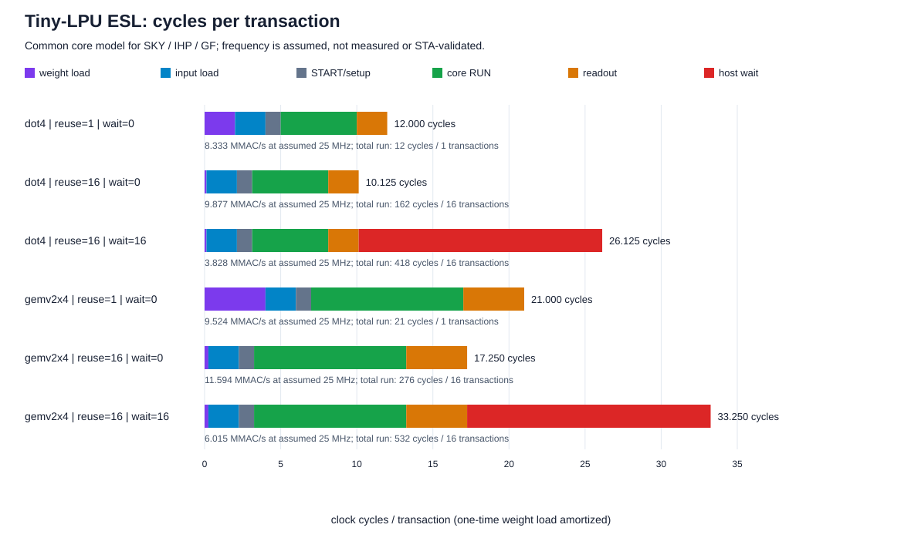

# Tiny-LPU ESL performance analysis — SKY

This report uses functional/cycle models. Frequencies are ESL assumptions; this runner performs no RTL synthesis, routing or STA.
SKY, IHP and GF each load their own pinned template metadata and instantiate the same core model. Equal workloads/resources/clocks give equal cycles; PDK, tile and nominal clock are metadata.

## Model and accounting

- A=[1,-2,3,-4]; dot4 W=[7,-8,-1,2] gives [12]; the second GEMV row [-8,7,0,-1] gives [12,-18].
- M is output rows (dot4=1, GEMV=2); N is transactions/weight reuse; H is extra host-wait clocks per transaction. Load W once, A each transaction.
- An 8-bit load transfers two INT4 values per clock; each INT16 output takes two readout clocks. A row executes a five-clock dot4; GEMV rows are serial.
- C_total = 2M + N*(3 + H + 7M): weights=2M, inputs=2N, setup=N, RUN=5MN, readout=2MN, wait=HN. Phases do not overlap.
- t_us=cycles/f_MHz; MMAC/s=MACs*f_MHz/C_total. One MAC counts one multiply-accumulate.
- Active utilization=MACs/RUN=0.8; overall utilization=MACs/C_total. Peak issue is one MAC/clock, not one dot4/clock.

## Template metadata

| Template | PDK | Action | Nominal period ns | Tile DIE_AREA um2 | Physical performance validated by this runner |
| --- | --- | --- | ---: | ---: | --- |
| sky | sky130A | ttsky26d | 20 | 17954.72 | false |

Tile boundary area does not prove usable cell area, fit or Fmax. This study does not invent technology-dependent cycle differences.

## Representative 25MHz scenarios

| Kernel | Reuse | Wait/transaction | RUN clocks | Total clocks | RUN us | Total us | MMAC/s | I/O fraction | Host-wait fraction | Overall utilization | Weight clocks/transaction |
| --- | ---: | ---: | ---: | ---: | ---: | ---: | ---: | ---: | ---: | ---: | ---: |
| dot4 | 1 | 0 | 5 | 12 | 0.200 | 0.480 | 8.333 | 50.0% | 0.0% | 33.3% | 2.000 |
| dot4 | 16 | 0 | 80 | 162 | 3.200 | 6.480 | 9.877 | 40.7% | 0.0% | 39.5% | 0.125 |
| dot4 | 16 | 16 | 80 | 418 | 3.200 | 16.720 | 3.828 | 15.8% | 61.2% | 15.3% | 0.125 |
| gemv2x4 | 1 | 0 | 10 | 21 | 0.400 | 0.840 | 9.524 | 47.6% | 0.0% | 38.1% | 4.000 |
| gemv2x4 | 16 | 0 | 160 | 276 | 6.400 | 11.040 | 11.594 | 36.2% | 0.0% | 46.4% | 0.250 |
| gemv2x4 | 16 | 16 | 160 | 532 | 6.400 | 21.280 | 6.015 | 18.8% | 48.1% | 24.1% | 0.250 |

## Conclusions

1. With no extra wait and one transaction, dot4 takes 12 clocks and GEMV 21; RUN is only 5/10 clocks. End-to-end throughput is below core throughput.
2. Reuse=16 gives dot4/GEMV totals of 162/276 clocks, or 10.125/17.25 per transaction. Weight load amortizes, but input/start/readout remain per transaction.
3. Adding 16 host-wait clocks per transaction raises those totals to 418/532. Weight reuse does not remove host wait.
4. At fixed cycles, 10/25/50MHz scales time and throughput only. This does not establish technology Fmax, power, physical area or I/O setup/hold.

## Reproducible data

- [Template performance table](performance.csv)
- [Template metadata, functional output and raw model JSON](model_results.json)
- Baseline traces: [dot4](traces/dot4.csv), [GEMV](traces/gemv2x4.csv)

Default sweep: 3 templates x 2 kernels x 3 reuse values (1/4/16) x 3 host waits (0/4/16) x 3 MHz assumptions (10/25/50) = 162 rows.
The quick sweep uses reuse=1/16, wait=0/16, 25MHz and 24 rows. Nonzero model exits, invalid JSON, incorrect outputs or cycle counts fail the runner.
